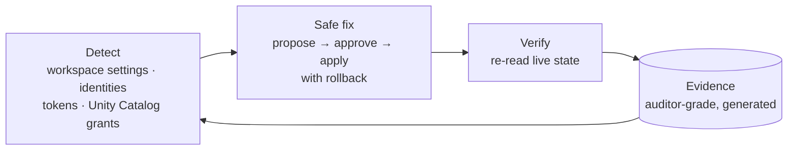

# Databricks Control Tool (DCT)

> **"Is my Databricks platform secure and compliant? Fix it, and prove it."** Answered as one closed loop instead of four disconnected steps.

Today, securing a data platform looks like this: **scan → alert list → someone fixes it by hand → screenshots for the auditor.** DCT turns that into a platform that keeps itself secure and **proves it, continuously**.

> 🔒 **Overview repo.** DCT is a product in development, so the source is private. [Get in touch](https://github.com/mjha-arya) for a walkthrough or a design-partner slot.

---

## The loop

## Where it sits

| Category | What it gives you | What's missing |
|---|---|---|
| Free best-practice checkers | A list of deviations with links | No fixes, no audit-grade evidence |
| Broad SaaS posture tools (SSPM) | Coverage across 100+ apps | Shallow inside Databricks |
| Compliance automation (Vanta / Drata style) | Evidence workflows | Only as deep as their integrations |
| CNAPP / CSPM | Cloud infrastructure | Stops at the platform boundary |
| **DCT** | **Databricks depth + safe-to-apply fixes + evidence an auditor accepts** | n/a |

## Design principles

- **Controls are data, the engine is the product.** Bring your own control set, mapped to your policy, with no code changes
- **Every fix is reversible** and gated by human approval. Nothing is applied that can't be rolled back
- **Unknown is never compliant.** If the tool can't see a setting, the report says so
- **Read-only by default.** Agents operate the tool through a read-only MCP server

## Built with
Python · Databricks SDK & REST APIs · Unity Catalog · system tables · MCP · Claude Agent SDK (agent operators)

---
Built by **Manish Jha**: secure and provable AI agents and data-platform security. [Profile →](https://github.com/mjha-arya)
